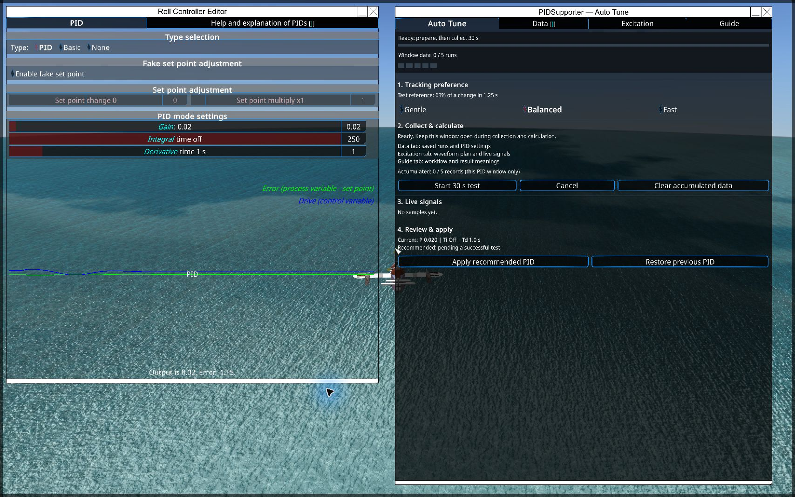

# PIDSupporter

In-game PID tune helper for From the Depths, implemented in C#.

[Steam Workshop](https://steamcommunity.com/sharedfiles/filedetails/?id=3735379602) · [User guide](AUTOTUNE.txt) · [Theory (English)](AUTOTUNE_THEORY_EN.md) · [이론 (한국어)](AUTOTUNE_THEORY_KO.md)

Version 1.1.4 updates documentation and packaging only. The 1.1.3 tuning algorithm and DLLs are retained. Both English and Korean theory Markdown files are included in the release.

The current runtime uses preparation-stage gain adjustment, fixed 30-second square-wave SP excitation, low-order linear instrumental-variable identification, and hierarchical PID search with neighboring parameter evaluation. Apply and Restore remain user-controlled. The previous FRIT implementation is retained in source history; it is not the current tuning path.

The theory document uses GitHub Markdown math (`$...$` and `$$...$$`). Open its rendered GitHub page or a math-capable Markdown viewer to see the equations.

## In-game interface



## Build

Install the .NET SDK and From the Depths, then run:

```powershell
./MakeRelease.ps1 -GameManagedDir 'C:/Program Files (x86)/Steam/steamapps/common/From The Depths/From_The_Depths_Data/Managed'
```

The script creates a local package in `PIDSupporter_Release`. It does not install or publish it. Game assemblies are referenced locally and are not included in this repository. Python is not required by the mod.

## Checks

```powershell
dotnet run --project tests/SessionChecks -c Release
```

The local research runners also contain optional experiments that need recordings; those recordings and local installation backups are not release assets.

## Limits

Identification assumes a useful local linear approximation and enough independent excitation. Coupled axes, changing operating conditions, and weak response may produce unreliable models. A recommendation is not a guarantee of stability or improvement; retain a known working PID and test changes in operation.
